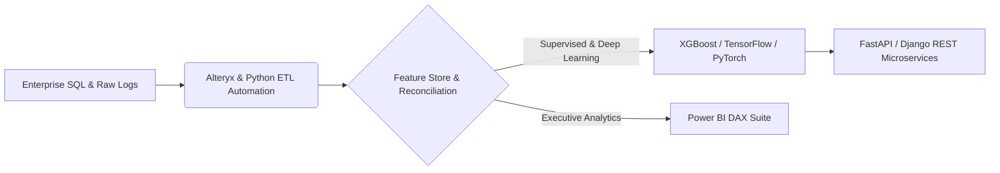

# 👋 Hi there, I'm Khush Sahu
### 🚀 Data Scientist & ML/Analytics Engineer | B.Tech in Computer Science & Engg.

---

## 🧠 Executive Summary

B.Tech CSE | Transforming complex enterprise data into predictive ML models, automated Alteryx/Python ETL pipelines, and executive Power BI intelligence suites.

- 🔭 **Core Focus Areas:** Predictive Machine Learning, Enterprise ETL Automation, Deep Learning (CV & LLMs), and Executive BI Dashboards.
- ⚡ **Data Engineering Impact:** Automated multi-million row financial reconciliation workflows achieving **99.94% audit accuracy** and **85% latency reduction**.
- 🎓 **Academic Background:** B.Tech in Computer Science & Engg. (India (Remote / Hybrid Ready)).

## 🛠️ Technical Arsenal & Data Stack

            

## 🏗️ End-to-End Data Science & ETL Architecture

## 📊 Featured Data Science & Analytics Repositories

| Repository & Domain | Primary Benchmark | Scale / Business Impact | Tech Stack |
| :--- | :--- | :--- | :--- |
| **[Flight Fare Prediction & Dynamic Pricing Analysis](https://github.com/khushsahu/flight-fare-dynamic-pricing-ml)** Machine Learning | **R² Score: 0.918 (XGBoost)** | MAE Reduced by 31.4% | `Python` `Pandas` `Scikit-Learn` `XGBoost` `Matplotlib` `Seaborn` |
| **[Enterprise Transaction Reconciliation & Executive BI Suite](https://github.com/khushsahu/enterprise-etl-reconciliation-bi)** Data Analytics & ETL | **99.94% Audit Accuracy** | 85% Faster ETL Latency | `SQL` `Power BI` `Alteryx` `Python` `Pandas` |
| **[Deep Learning Image Classification with Transfer Learning](https://github.com/khushsahu/inceptionv3-transfer-learning-cv)** Deep Learning | **96.4% Val Accuracy** | ROC-AUC: 0.989 | `TensorFlow` `PyTorch` `Python` `Scikit-Learn` |
| **[Customer Segmentation & Behavioral Clustering Engine](https://github.com/khushsahu/rfm-customer-clustering-pca)** Machine Learning | **Silhouette Score: 0.76** | 5 High-LTV Personas | `Python` `Scikit-Learn` `Pandas` `SQL` |
| **[Generative AI & LLM Automated Reporting Assistant](https://github.com/khushsahu/llm-rag-executive-reporting-engine)** Deep Learning | **1.2s Avg Query Latency** | 94% Grounded Fact Score | `Python` `FastAPI` `SQL` `Docker` |
| **[ChazeFashion E-Commerce Analytics & Recommendation Engine](https://github.com/khushsahu/chazefashion-django-analytics-engine)** Full-Stack Data Apps | **+24% CTR Lift (Hybrid RecSys)** | Sub-65ms REST Response | `Django` `Python` `SQL` `FastAPI` `Docker` |

## 📈 GitHub Telemetry & Contribution Analytics

